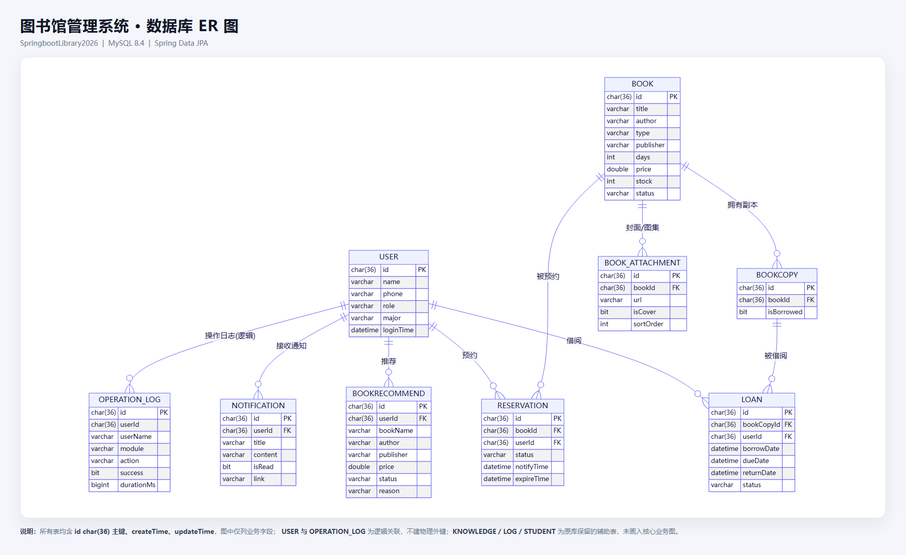
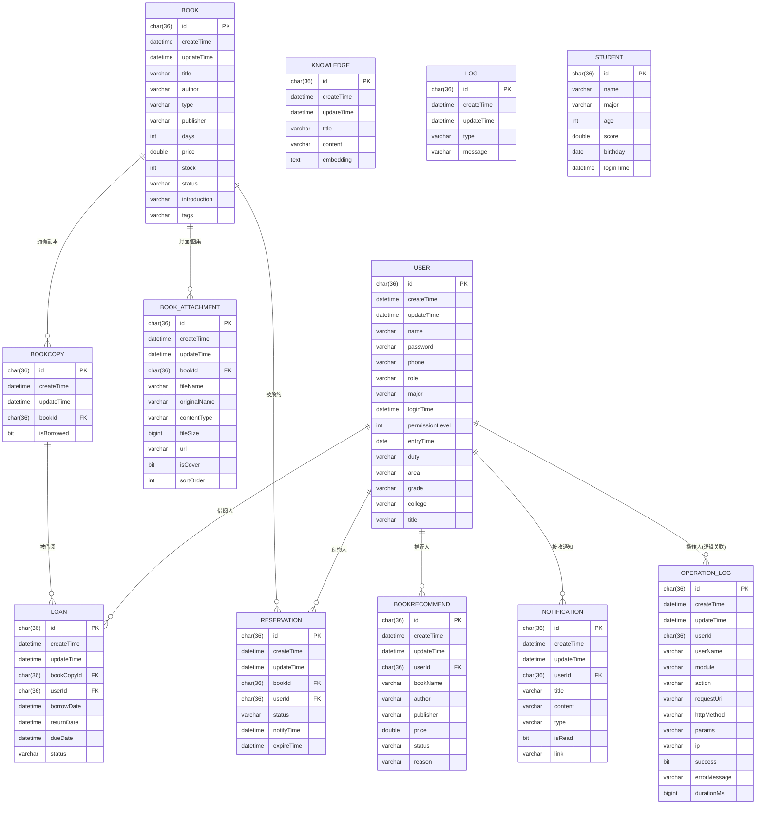

# 数据库 ER 图

> 核心业务共 9 张表：`user`、`book`、`bookcopy`、`loan`、`bookrecommend`、
> `book_attachment`、`reservation`、`notification`、`operation_log`。
> 原有表来自 `librarydb.sql`；`book_attachment`、`reservation`、`notification`、`operation_log`
> 由 `sql/schema.sql` 创建。`knowledge`、`log`、`student` 为原库保留的辅助表，其中 `log` 的字段较简单，
> 本项目改用 `operation_log` 记录 AOP 日志。

## 关键关系与约束

| 外键 | 说明 |
| --- | --- |
| `bookcopy.bookId -> book.id` | 一本书对应多个副本 |
| `loan.bookCopyId -> bookcopy.id` | 一条借阅对应一个具体副本 |
| `loan.userId -> user.id` | 借阅人 |
| `bookrecommend.userId -> user.id` | 推荐人 |
| `book_attachment.bookId -> book.id` | 一本书多张图片，`ON DELETE CASCADE` |
| `reservation.bookId -> book.id` | 预约的图书 |
| `reservation.userId -> user.id` | 预约人 |
| `notification.userId -> user.id` | 通知接收人 |

## 设计说明

1. 所有新增表主键/外键使用 `char(36) COLLATE utf8mb4_general_ci`，与原有 `book.id`、`user.id` 的字符集/排序规则一致，否则 MySQL 无法创建外键。
2. `book.stock` 是可借库存，不是副本总数；副本总数由 `bookcopy` 统计。
3. `bookcopy.isBorrowed` 使用 `bit(1)`，JPA 用 `Boolean` 映射。
4. `reservation.status` 取值：`等待中`、`可借`、`已取消`、`已完成`、`已过期`。
5. `operation_log` 不建用户外键，避免删除用户时影响历史日志；`userId/userName` 为逻辑关联。